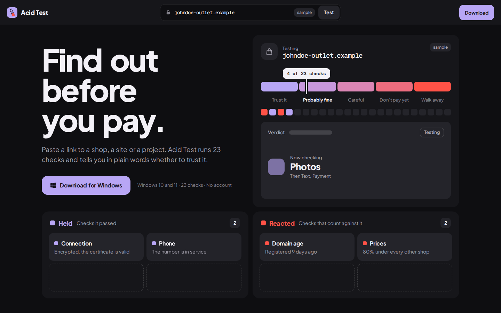
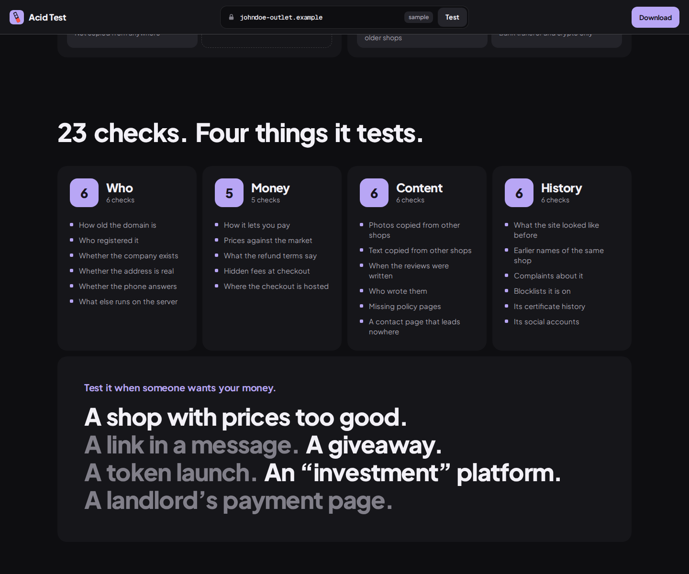
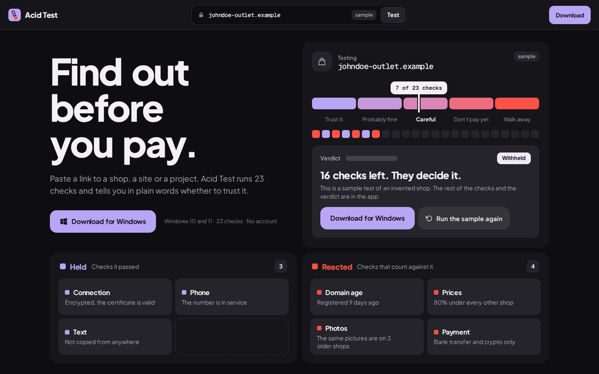

<h1 align="center">Acid Test: OSINT check for suspicious sites, shops and projects</h1>

<b>Find out before you pay.</b> Paste a link. 23 checks. One plain answer.

OSINT · OSINT tool · scam checker · website checker · fraud prevention · due diligence · phishing · windows

> **Status: v1.1.4.** The app is out — [download Acid for Windows](https://awesomeosint.tools/acid-test/).

## Why this exists

Every week a new shop, a new airdrop, a new "guaranteed" project — and the same question: is this real? The answer should not depend on how confident the page sounds.

## Why it is different

Most checkers give you a score and hide the math. Here every check is shown: what was asked, what answered, and which side of the strip it landed on. The evidence sits next to the verdict, so you can disagree with it.

## The idea

- **One object.** A litmus strip: a pad stays lilac while a check holds and turns red when it reacts.
- **One number.** 23 checks.
- **Colour.** Lab-bench black `#0E0E11`, litmus lilac `#B8A6F5` for what held, red `#FF5247` for what reacted, and five flat steps between them for the scale.
- **The main feature.** One plain answer with the evidence: five possible verdicts from "Trust it" to "Walk away", and next to it every check sorted into what held and what reacted.
- **The frame.** Everything sits on one centre line: held to the left, reacted to the right.

## The demo on the page

Seven checks run on an invented shop. Each one lands in the Held card if it held or the Reacted card if it reacted, and the marker on the scale moves with it. After seven it stands on "Careful", with four reactions against three holds, and stops: the other sixteen checks and the verdict are in the app.

